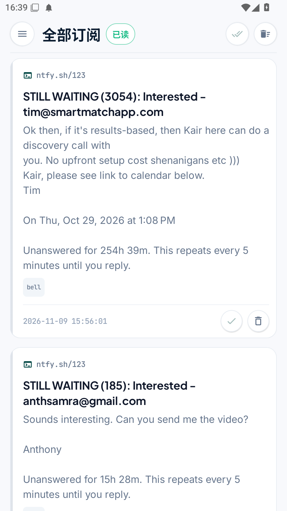
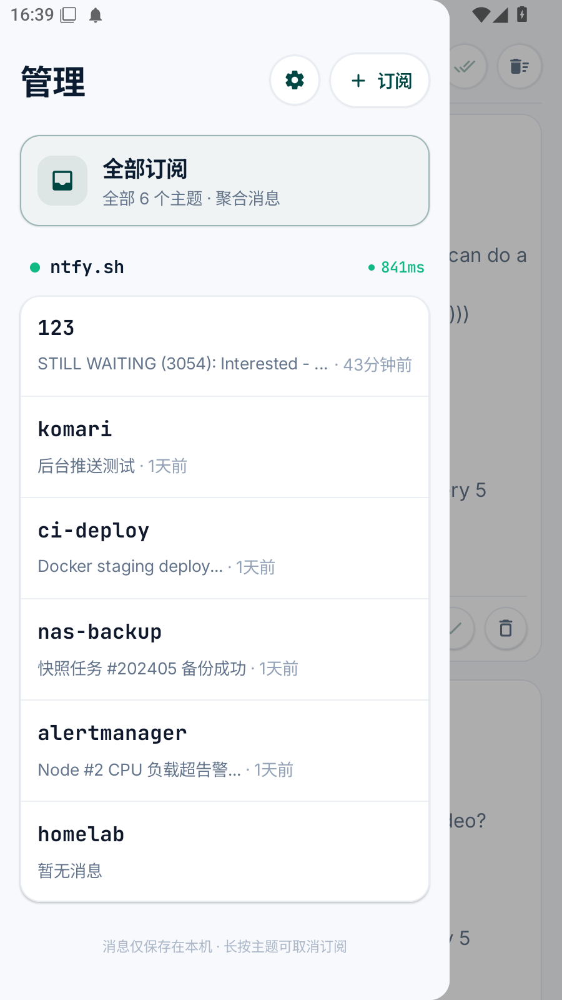
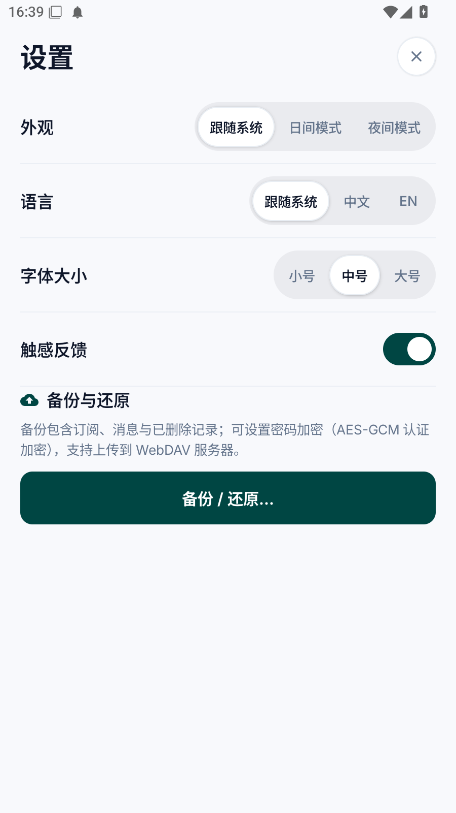
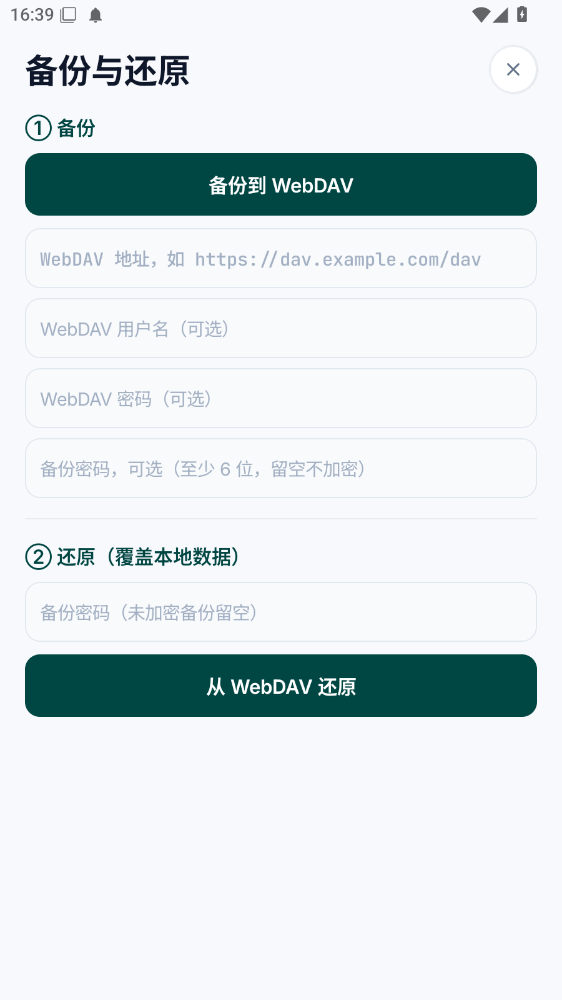

# Ntfy Hub

一款基于 [ntfy](https://ntfy.sh) 协议的 Android 订阅中心客户端。实时接收自建或公共 ntfy 服务器的推送消息，支持多服务器、多主题聚合管理，所有数据仅保存在本机。

> 配套的浏览器端扩展：[ntfy-extension](https://github.com/codecodegogogo/ntfy-extension)——在浏览器里接收和发送 ntfy 通知，与手机端共用同一个 ntfy 服务器。

<p align="center">
  <table>
    <tr>
      <td align="center"><br /><sub>消息首页</sub></td>
      <td align="center"><br /><sub>订阅管理</sub></td>
      <td align="center"><br /><sub>设置</sub></td>
      <td align="center"><br /><sub>备份与还原</sub></td>
    </tr>
  </table>
</p>

## 特性

- **实时消息流**：每个主题一条 `/topic/json?since=...` 长连接，断线指数退避自动重连（1s → 60s），停留在顶部时新消息自动滚动到最新。
- **订阅管理侧栏**：首页向右滑动打开，按服务器分组展示连接状态、延迟与未读数；长按服务器可删除全部订阅、断开或重连；长按主题可取消订阅。
- **聚合与单主题视图**：默认聚合展示全部订阅的消息，也可切换到单个主题；下拉刷新在聚合页拉取全部、在单主题页只拉取当前主题。
- **消息操作**：单条已读、删除（可撤销）、全部已读、清空；附件消息一键下载到系统 Downloads；点击带 `click` 字段的消息用浏览器打开链接。
- **系统通知**：前台服务保持连接，新消息以 heads-up 方式弹出系统通知（带声音与震动），支持通知栏「标记已读」，点击通知直达对应主题。
- **主题备注**：输入「主题//备注」即可起别名，例如 `komari//探针`，消息卡片、管理页和通知都会显示「探针」，实际连接的仍是 `komari`。
- **三态外观**：跟随系统 / 日间 / 夜间模式，状态栏图标同步适配。
- **字体大小**：小号 / 中号（默认）/ 大号，全局缩放，立即生效。
- **多语言**：简体中文 / English，跟随应用内设置即时切换。
- **触感反馈**：可开关的触感反馈，覆盖分段选择器、按钮等交互。
- **备份与还原**：订阅、消息与已删除记录打包为 JSON，上传到 WebDAV 服务器；可选密码加密（PBKDF2 派生密钥 + AES-GCM 认证加密），随时从 WebDAV 一键还原。
- **本地持久化**：订阅、消息与已删除记录保存到应用私有目录的 JSON 文件（`files/hub_state.json` 等），最多保留 800 条消息（每主题 250 条），不上传任何数据。

## 安全性

**传输协议**：连接 ntfy 服务器使用 **HTTPS + SSE**（Server-Sent Events，服务器单向推送事件流）。订阅是标准 HTTPS 长连接（`GET /topic/json?since=...`），不是自研协议；WebDAV 备份同样走 HTTPS。

**能否被抓包**：

| 场景 | 风险 |
|---|---|
| 服务器地址以 `https://` 开头 | 传输全程 TLS 加密，中间人无法看到消息内容，抓包工具（如 Charles、Wireshark）只能看到加密流量 |
| 服务器地址以 `http://` 开头 | **明文传输**，同网络内可被截获——建议始终使用 https |
| 服务器开启了身份认证 | 应用支持 Basic 认证与访问令牌（`tk_...`），凭据仅保存在本机，随请求发送时同样受 TLS 保护 |
| 主题名本身 | ntfy 的主题名不加密（TLS 之下的 URL 路径），任何人只要知道主题名就能订阅——**请把主题名当作密码对待**，自建服务器或使用复杂主题名 |

**本地数据**：订阅与消息保存在应用私有目录（其他应用无法读取）；备份上传前可加密码（PBKDF2-SHA256 派生密钥 + AES-GCM 认证加密），即使 WebDAV 服务器上的备份文件被拿到也无法解出内容。

> 建议：使用 `https://` 服务器、给订阅设置访问控制、主题名避免使用可猜测的单词。

> 注意：为兼容自建服务器的 http 地址，应用允许明文流量（`usesCleartextTraffic="true"`）。如果你只连接 https 服务器，可在 `AndroidManifest.xml` 中移除该行以强制加密。

## 技术栈

| 项目 | 说明 |
|---|---|
| 语言 | Kotlin |
| UI | Jetpack Compose + Material 3 |
| 架构 | 单 Activity + ViewModel + Repository + StateFlow/SharedFlow |
| 网络 | OkHttp（SSE 长连接、WebDAV 备份） |
| 最低支持 | Android 8.0（API 26），目标 Android 16（API 36） |

## 构建

```bash
# Debug 构建
./gradlew assembleDebug

# Release 构建（需要签名配置）
./gradlew assembleRelease
```

Release 签名通过项目根目录的 `keystore.properties` 配置（`storeFile` / `storePassword` / `keyAlias` / `keyPassword`），密钥文件放在 `keystore/` 目录。这两项不纳入版本控制。

## 项目结构

```
app/src/main/java/dev/ntfy/hub/
├── MainActivity.kt        # 入口：主题、语言、字体、触感等全局状态
├── NtfyApp.kt             # Application：初始化仓库与通知渠道
├── data/
│   ├── Models.kt          # 消息 / 订阅等数据模型（含附件字段）
│   ├── NtfyRepository.kt  # SSE 长连接、消息解析、订阅管理
│   ├── HubStore.kt        # JSON 持久化（原子写）
│   └── BackupManager.kt   # 备份导出 / 解析 / 加密 / WebDAV
├── service/
│   ├── NtfyService.kt     # 前台服务
│   └── Notifications.kt   # 通知渠道与消息通知
└── ui/
    ├── HubApp.kt          # 根组件：抽屉导航 + 页面调度
    ├── HubViewModel.kt
    ├── components/        # 通用组件（分段选择器、输入框、徽章等）
    ├── theme/             # 配色 / 字体 / 三态主题
    └── screens/           # 首页 / 管理页 / 设置页 / 备份页 / 添加订阅
```

## 许可

仅供学习与个人使用。
